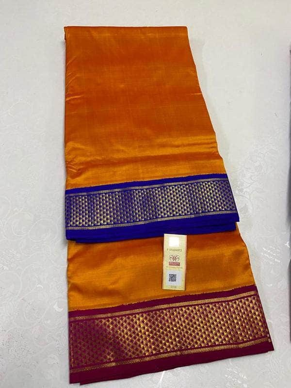

# Thari (தறி)

**A maker sells to the world by speaking to her phone, and the buyer can see proof the thing was made by hand.**

A handloom weaver in Tamil Nadu lists a saree by voice. A buyer in Boston pays with PayPal. The money splits to the weaver and her co-op automatically, and she hears about it in her own language. The demo is handloom; [the mechanism isn't](#where-this-goes).

Built for the [PayPal AI Hackathon 2026](https://paypalaihackathon.devpost.com/).

🔗 **Live:** https://thari-paypal.vercel.app — start at [`/demo`](https://thari-paypal.vercel.app/demo) and pick a role. No sign-up.

---

## The problem

A Kanchipuram silk saree takes six weeks on a pit loom. A trader pays the weaver a fraction of what it sells for abroad, and buyers overseas have no way to tell real handloom from a mill-made copy. The weaver has a phone, but she doesn't type English, and marketplaces are built around typing English.

Thari removes both barriers: she speaks, and the piece carries proof it was made by hand.

## What it does

**She speaks.** A voice note in Tamil — or Hindi, Telugu, Bengali — becomes a structured listing: fabric, colours, motifs, length, price. Gemini extracts the facts, writes the English title, description and craft story, and converts rupees to dollars. When something's missing it **asks her, in her language**, and she answers by voice. Nothing goes live until she hears it read back and says yes.

**The co-op vouches for it.** Her weavers' cooperative watches the loom clip and confirms the piece is genuinely handwoven. Only then does the gold **Verified handwoven** badge appear. The weaver cannot grant it to herself and neither can the AI — the API returns 403 to anyone but the co-op, and refuses outright when there is no loom clip to vouch for.

**A buyer pays.** On the site, or through an AI agent. PayPal Orders v2 handles checkout; the amount always comes from the database, never from the browser.

**The money splits itself.** PayPal Payouts sends the weaver her share and the co-op its commission in one batch — $184.50 and $20.50 on a $205 saree — and she gets a message in Tamil: *உங்கள் புடவை விற்பனையானது. ₹16,236 உங்களுக்கு வருகிறது.*



## Try it in 90 seconds

Open [`/demo`](https://thari-paypal.vercel.app/demo) and click through all three roles.

| Role | What to look at |
|---|---|
| **Weaver** | `/w/new` → "use sample voice note" → skip photos and clip. The AI asks the length question **in Tamil**. Answer with the sample, hear the read-back, publish. Switch her language in the top right. |
| **Co-op** | `/coop` → play a loom clip, press **Confirm**, then look at that piece on the shop: the gold badge is now there. |
| **Buyer** | Any piece → **Pay with PayPal** → sign in with the sandbox buyer. Then check the co-op's **Payouts** grid. |

Sandbox buyer credentials are shown on `/demo` itself. **No real money moves.**

## How PayPal is used

| Product | Where |
|---|---|
| **Orders v2** | `src/lib/paypal/orders.ts` — create and capture, totals computed server-side |
| **Payouts v1** | the weaver/co-op split, one batch per order |
| **Payments v2** | refunds, from the co-op dashboard |
| **Webhooks** | `src/app/api/paypal/webhook/route.ts` — signature-verified, idempotent |
| **JS SDK v6** | `src/components/PayPalButton.tsx` |

Three things we were careful about:

- **Every write carries a `PayPal-Request-Id`** derived from our own order id. The fetch helper *throws* if a write is attempted without one, so a retry can never double-charge or double-pay.
- **One idempotent fulfilment function.** The capture route and the webhook both call `fulfillOrder`, which claims the order with a single atomic write (`set fulfilledAt where fulfilledAt is null`). Whichever arrives first does the work; the other is a no-op. [Unit tested](src/tests/fulfill.test.ts), including that the split never loses or creates a cent.
- **Every webhook event is verified with PayPal before we act.** The endpoint is public, so an unverified body is just a stranger's claim that someone got paid. A forged `PAYMENT.CAPTURE.COMPLETED` gets a 400.

## How AI is used

Gemini, through one wrapper (`src/lib/ai/client.ts`) that gives every call a 45-second timeout, one retry, Zod validation of the output, an `AgentLog` row, and a typed error the UI can show.

- **Voice → listing** (`extractListing`) — audio plus photos in, structured JSON out, validated against a Zod schema. The prompt forbids inventing fabric, measurements, prices or certifications, and records conflicts between what she said and what the photos show.
- **Spoken answers** (`answerQuestion`) — her reply to a follow-up question, understood and merged.
- **Text-to-speech** — her language, for the read-back and the sale notification.

Two deliberate design choices:

- **The sale notification is a template, not AI.** "₹16,236 is coming to you" is a financial statement; it must not be paraphrased.
- **The model falls through a list of models on overload.** Gemini returned 503 "experiencing high demand" during development, so a busy model degrades to an older one rather than failing the demo.

`AI_MODE=mock` runs the whole weaver flow from fixtures with no API key.

## Agentic commerce

The same three tools are defined once (`src/lib/tools.ts`) and exposed two ways:

- **In-app assistant** at `/assistant` — Gemini function calling
- **MCP endpoint** at `/api/mcp` — add it to Claude as a custom connector

```
https://thari-paypal.vercel.app/api/mcp
```

Try: *"Find me a verified handwoven silk saree under $250 and get it ready for checkout."*

| Tool | Does |
|---|---|
| `search_listings` | up to 6 live pieces with weaver, price, and whether the co-op verified it |
| `get_listing` | full details and the evidence behind the badge |
| `create_checkout` | prepares a PayPal order, returns an `approveUrl` — **it does not pay** |

**An AI never moves money.** `create_checkout` returns `paid: false` and a link a human must approve. The tool says so in its own output rather than trusting the caller to be careful.

There's also [`/api/catalog.json`](https://thari-paypal.vercel.app/api/catalog.json) — schema.org-shaped, with `verifiedHandwoven` and the evidence sentence — plus JSON-LD on every product page, for agents that don't speak MCP.

## Running it locally

Needs Node 22+.

```bash
git clone https://github.com/Shoaibahmed-2005/Thari_Paypal.git
cd Thari_Paypal
npm install
cp .env.example .env.local      # fill in, see below
npx prisma migrate dev --name init
npx prisma db seed
npm run dev
```

Minimum to see the whole app: `DATABASE_URL` and `DIRECT_URL` (any Postgres; [Neon](https://neon.tech) free tier works), `SESSION_SECRET`, and `AI_MODE=mock`. Add `GEMINI_API_KEY` for live AI and the PayPal sandbox keys for live checkout. `npm run dev` prints anything missing.

```bash
npm test          # 31 unit tests
npm run typecheck
npm run lint
npm run build
```

## Project structure

```
src/
  app/                 routes — buyer (/), weaver (/w), co-op (/coop), API
  components/          UI; brand CSS lives in app/globals.css
  lib/
    ai/                Gemini: client, prompts, Zod schemas, mock fixtures
    paypal/            orders, payouts, capture, refunds, webhook, fulfilment
    tools.ts           the three tools shared by the assistant and MCP
    money.ts fsm.ts    pricing, splits, order/listing state machines
    languages.ts i18n.ts   the weaver's language and her UI strings
  tests/               unit tests for the money, the state machines, fulfilment
prisma/                schema, migration, idempotent seed
docs/                  the full build plan and the running progress log
```

## Where this goes

The demo is handloom because a demo should be one thing done completely. The product isn't.

**Already craft-agnostic, in this codebase:** everything after the listing exists. Checkout, the weaver/co-op split, payouts, refunds, the order state machine, the sale notification in her language, the assistant and the MCP endpoint — none of it knows what a saree is. Listings carry a `category`, and the weaver's language is a setting (Tamil, Hindi, Telugu, Bengali, English today; Gemini handles far more).

**The verification idea generalises, which is the part that matters.** The badge isn't "we checked a certificate", it's *film the making, and have a second party who knows the craft vouch for the footage*. A potter films the wheel. A Rajasthani bangle-maker films the lac work. A Channapatna toymaker films the lathe. Same loom clip, same co-op confirmation, same gold badge — and co-operative societies already exist across Indian crafts, so the human institution is there too.

**What a new craft would need:** its own listing attributes (a saree has `fabric`, `weave`, `lengthMeters`, `includesBlouse`; a bangle has size, metal, technique) and a matching extraction prompt. That's a schema and a prompt per craft, not a rewrite.

**What it would need beyond that:** food and perishables carry different export paperwork from textiles, so the document generation is genuinely per-category work.

## Known limitations

Said plainly, because a demo that hides its edges is worth less than one that doesn't:

- **Sign-in is three demo roles, not real accounts.** `/demo` exists so judges can be each person in one click. Sign-up was never in scope.
- **Hindi, Telugu and Bengali UI strings were written by the model.** Tamil is verified by a native speaker; the others want a human pass.
- **Refunds don't claw back payouts.** If the money has already gone to the weaver, the dashboard says so and asks the co-op to recover it by hand.
- **Recording a new voice note in the browser produces WebM**, which Gemini doesn't accept; the sample notes are AAC and work. A WAV encoder is the fix.
- Shipping is a flat $20 and FX is a fixed rate from an environment variable.

## Credits

- Saree photographs and the loom clip: supplied by the project owner.
- Home hero: photo by [Sanjay Adhitya](https://www.pexels.com/@sanjay-adhitya-2153341322/) via [Pexels](https://www.pexels.com/photo/indian-weaver-crafting-traditional-textiles-32673642/), Pexels licence. A real weaver at a pit loom — not one of the seeded weavers, who are fictional.
- Tamil sample voice notes: recorded by the project owner.
- The weavers, the co-op and the buyer in the seed data are fictional. Sandbox PayPal accounts move no real money.

## Licence

MIT — see [LICENSE](LICENSE).
